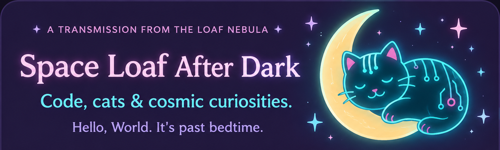
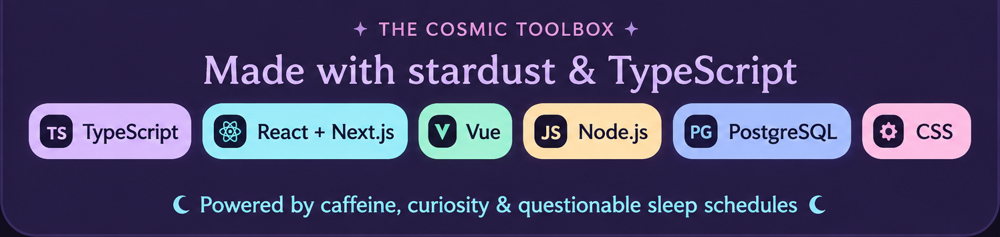

### ✨ Software Engineer with a focus in accessibility-compliant front-end (UI/UX) development

I build thoughtful, accessible experiences
with code, curiosity, and a little cosmic chaos.

### 🪐 Currently Orbiting

**Ally** · Accessibility-first React components

**Familiar** · Cozy project management

**Space Loaf Labs** · Creative experiments

**[maiko.dev](https://maiko.dev)** · My portfolio

